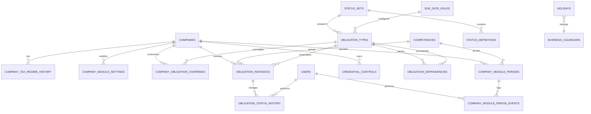

# PRD — Sistema de Controle de Obrigações para Escritório Contábil

**Versão:** 1.0  
**Status:** Especificação inicial do MVP  
**Data:** 27/09/2026  
**Plataforma:** Web/Desktop  
**Escopo inicial:** Escritório único, aproximadamente 300 empresas, 1 usuário operacional no MVP

---

## 1. Resumo executivo

O produto será um sistema web para centralizar e controlar as obrigações recorrentes de um escritório contábil, substituindo controles distribuídos em planilhas por uma base única, histórica e organizada por competência.

O sistema terá um **cadastro único de empresas** e módulos operacionais para:

- Fiscal;
- Declarações;
- Contábil;
- Folha;
- DCTFWeb e seus componentes;
- Procurações e certificados digitais.

A única área com visualização operacional distinta conforme o regime será o **módulo Fiscal**, no qual as empresas do Simples Nacional terão um conjunto de controles diferente das demais empresas.

Todas as demais áreas trabalharão sobre o mesmo cadastro de empresas, respeitando a aplicabilidade de cada módulo e obrigação.

O sistema será orientado por **competência mensal**, preservará o histórico de cada período e permitirá acompanhar a evolução operacional, obrigações concluídas, pendências, atrasos, vencimentos e backlog de competências anteriores.

O objetivo principal do MVP é eliminar quatro problemas operacionais:

1. atraso de obrigações;
2. perda ou dispersão de planilhas;
3. dificuldade de visualizar e gerir o andamento do escritório;
4. duplicidade de controles e informações.

---

# 2. Objetivos do produto

## 2.1 Objetivo principal

Criar uma fonte única de verdade para o controle mensal das obrigações do escritório, permitindo identificar rapidamente:

- o que precisa ser feito;
- o que já foi iniciado;
- o que foi concluído;
- o que possui pendência;
- o que está atrasado;
- quais competências permanecem abertas;
- quais certificados ou procurações estão próximos do vencimento;
- qual usuário executou uma alteração relevante;
- qual é o estado atual de cada empresa em cada setor.

## 2.2 Objetivos secundários

- reduzir controles paralelos;
- evitar duplicação do mesmo dado entre módulos;
- facilitar o fechamento mensal dos setores;
- permitir análise histórica por competência;
- criar base técnica para aumento futuro da equipe;
- permitir importação e exportação em Excel;
- permitir relatórios em PDF;
- preparar a estrutura para permissões por departamento no futuro;
- permitir inclusão futura de novas obrigações sem alteração estrutural do sistema.

## 2.3 Critério principal de sucesso do MVP

O MVP será considerado funcional quando conseguir controlar integralmente o ciclo mensal de aproximadamente 300 empresas, incluindo:

1. cadastro e configuração das empresas;
2. abertura automática da competência;
3. geração das obrigações aplicáveis;
4. atualização individual e em massa dos status;
5. cálculo de vencimentos e atrasos;
6. visualização do progresso e das pendências;
7. fechamento independente por empresa e setor;
8. reabertura controlada;
9. navegação histórica entre competências;
10. exportação dos controles.

---

# 3. Escopo do MVP

## 3.1 Incluído no MVP

- aplicação web responsiva para desktop;
- cadastro único de empresas;
- aproximadamente 300 empresas suportadas sem degradação perceptível na operação normal;
- 20 empresas fictícias pré-cadastradas para demonstração;
- regimes tributários com histórico;
- ativação/desativação de módulos por empresa;
- aplicabilidade de obrigações por empresa;
- competências mensais;
- abertura automática de competência;
- fechamento independente por empresa e módulo;
- reabertura com motivo, data, hora e usuário;
- módulo Fiscal — empresas normais;
- módulo Fiscal — Simples Nacional;
- módulo Declarações;
- módulo Contábil;
- módulo Folha;
- visão de DCTFWeb e componentes;
- módulo Procurações e Certificados;
- upload/substituição de documento vigente de procuração e de material de certificado sem chave privada;
- catálogo configurável de obrigações;
- regras de prazo por obrigação;
- cálculo de vencimento considerando finais de semana e feriados;
- alteração excepcional do vencimento por instância;
- status configurados por tipo de processo;
- histórico de mudanças de status;
- observação geral por empresa/módulo/competência;
- dashboard operacional;
- backlog;
- filtros e pesquisa;
- alterações em massa;
- importação de empresas via XLSX/CSV;
- exportação para Excel;
- relatórios em PDF;
- estrutura de dados preparada para permissões futuras;
- usuário administrativo implícito no MVP.

## 3.2 Fora do MVP

- MEI;
- pessoa física;
- Carnê-Leão;
- matriz e filiais;
- múltiplos escritórios/arquitetura SaaS multi-tenant;
- autenticação e login;
- múltiplos usuários simultâneos como requisito operacional;
- notificações internas;
- notificações por e-mail;
- notificações por WhatsApp;
- anexos em obrigações operacionais;
- integração com sistemas contábeis externos;
- sincronização automática de cadastro com outro sistema;
- segunda aprovação/revisão por outro usuário;
- responsável substituto;
- filtros salvos;
- operação completa em dispositivos móveis;
- auditoria geral de todas as entidades do sistema;
- backups gerenciados pela interface;
- múltiplas procurações do mesmo tipo por empresa;
- múltiplos certificados simultaneamente ativos por empresa;
- obrigações anuais, trimestrais ou eventuais;
- armazenamento de senha, chave privada ou segredo de certificado digital.

---

# 4. Premissas do produto

1. O sistema atenderá inicialmente um único escritório.
2. O volume esperado é de aproximadamente 300 empresas.
3. O MVP será utilizado inicialmente por uma única pessoa.
4. A aplicação será web e priorizará desktop/notebook.
5. Todos os módulos descritos neste documento fazem parte do MVP.
6. O cadastro de empresa será único e compartilhado entre todos os módulos.
7. O sistema não cadastrará MEI no escopo operacional do MVP.
8. O sistema não cadastrará pessoas físicas no MVP.
9. Toda rotina operacional será orientada por competência mensal `MM/AAAA`.
10. Alterações de configuração de empresa afetarão somente competências futuras.
11. Dados históricos de competências já geradas serão preservados.
12. Obrigações compartilhadas por mais de uma tela deverão possuir um único registro canônico no banco de dados.

---

# 5. Definições importantes

## 5.1 Empresa normal

Para o sistema, o agrupamento operacional **Normal** é uma classificação de interface utilizada no módulo Fiscal.

São consideradas empresas normais as empresas enquadradas nos seguintes regimes:

- Lucro Presumido;
- Lucro Real;
- Lucro Arbitrado;
- Imune/Isenta.

O agrupamento `Normal` não deverá substituir o regime tributário real no cadastro.

## 5.2 Simples Nacional

Empresas cujo regime tributário vigente na competência seja `Simples Nacional`.

## 5.3 Competência

Período mensal representado internamente como `AAAA-MM` e exibido ao usuário como `MM/AAAA`.

Exemplo:

- armazenamento: `2026-09`;
- interface: `09/2026`.

## 5.4 Obrigação

Item operacional controlável dentro de um módulo.

Exemplos:

- Entradas;
- PIS;
- REINF;
- SPED Fiscal;
- Conciliação;
- eSocial.

## 5.5 Instância de obrigação

Registro de uma obrigação aplicado a uma empresa e competência específicas.

Exemplo:

> SPED Fiscal — Empresa Alfa — competência 09/2026.

## 5.6 Aplicabilidade

Determina se uma obrigação deve ser controlada para determinada empresa.

Pode decorrer de:

- regime tributário;
- módulo contratado/atendido pelo escritório;
- regra padrão da obrigação;
- configuração individual da empresa.

## 5.7 Fechamento de módulo

Encerramento operacional de uma empresa em um módulo e competência específicos.

Exemplo:

> Fiscal da Empresa Alfa em 09/2026 = fechado.

O fechamento do Fiscal não deverá fechar automaticamente Contábil, Folha ou Declarações.

---

# 6. Arquitetura funcional

O sistema deverá ser dividido nas seguintes áreas principais:

1. Dashboard;
2. Empresas;
3. Fiscal;
4. Declarações;
5. Contábil;
6. Folha;
7. DCTFWeb;
8. Procurações e Certificados;
9. Backlog;
10. Cadastros e Configurações;
11. Importação/Exportação;
12. Relatórios.

---

# 7. Cadastro único de empresas

## 7.1 Campos obrigatórios

Cada empresa deverá possuir:

- ID interno do sistema;
- código interno do escritório;
- razão social;
- nome fantasia;
- CNPJ;
- regime tributário vigente;
- data de início do atendimento;
- data de encerramento do atendimento, quando aplicável;
- situação: ativa ou inativa;
- município;
- UF;
- inscrição estadual, quando houver;
- inscrição municipal, quando houver;
- responsável Fiscal;
- responsável Contábil;
- responsável Folha;
- responsável Declarações;
- observações cadastrais gerais.

## 7.2 Restrições

- CNPJ deverá ser único.
- Código interno deverá ser único.
- Não deverá ser permitida exclusão física de empresas que já tenham histórico.
- Empresa deverá ser inativada/cancelada.
- Empresas fora do período de atendimento não deverão receber novas obrigações.

## 7.3 Copiar CNPJ e código

Na listagem e no cabeçalho da ficha da empresa deverão existir ações rápidas:

- `Copiar CNPJ`;
- `Copiar código`.

O CNPJ copiado deverá ser colocado na área de transferência **somente com números**, sem ponto, barra, hífen ou espaços.

Exemplo:

`00.000.001/0001-01` → `00000001000101`

A interface poderá continuar exibindo o CNPJ formatado.

## 7.4 Ativação de módulos

Cada empresa deverá possuir configuração individual para:

- Fiscal: ativo/inativo;
- Declarações: ativo/inativo;
- Contábil: ativo/inativo;
- Folha: ativo/inativo;
- Procurações/Certificados: ativo/inativo.

A DCTFWeb não será tratada como módulo contratual independente; será uma visão operacional composta por obrigações compartilhadas entre Declarações, Fiscal e Folha.

## 7.5 Período de atendimento

Campos:

- `atendimento_inicio`;
- `atendimento_fim` opcional.

Regra:

- competências anteriores ao início não geram obrigações;
- competências posteriores ao fim não geram obrigações;
- competências históricas existentes permanecem disponíveis.

---

# 8. Histórico de regime tributário

## 8.1 Regimes disponíveis

- Simples Nacional;
- Lucro Presumido;
- Lucro Real;
- Lucro Arbitrado;
- Imune/Isenta.

MEI não deverá aparecer no catálogo do MVP.

## 8.2 Regra de vigência

Toda alteração de regime deverá registrar:

- regime anterior;
- novo regime;
- competência inicial de vigência;
- usuário responsável;
- data/hora do registro.

Exemplo:

| Regime | Vigência inicial | Vigência final |
|---|---:|---:|
| Simples Nacional | 01/2025 | 06/2026 |
| Lucro Presumido | 07/2026 | atual |

## 8.3 Imutabilidade histórica

Alterar o regime atual de uma empresa não poderá modificar automaticamente competências anteriores.

O regime usado em uma competência deverá ser preservado no snapshot daquela competência.

---

# 9. Configuração de aplicabilidade

## 9.1 Regra geral

O sistema deverá possuir dois níveis:

1. regra padrão do catálogo;
2. override por empresa.

Exemplo:

- IPI pode ser padrão para determinada classe de empresas normais;
- Empresa Beta pode possuir `IPI = não se aplica`;
- competências futuras refletirão o override;
- competências já criadas não serão alteradas.

## 9.2 Configurações possíveis

Para cada obrigação por empresa:

- `Padrão`;
- `Aplicável`;
- `Não se aplica`.

## 9.3 Persistência da dispensa

Quando uma obrigação for configurada como não aplicável/dispensada no cadastro da empresa, essa configuração continuará valendo nas novas competências até alteração manual.

---

# 10. Competências

## 10.1 Abertura automática

A competência mensal deverá ser criada automaticamente pelo sistema.

Ao iniciar uma nova competência, o sistema deverá:

1. identificar as empresas ativas no período;
2. identificar o regime vigente de cada empresa;
3. identificar os módulos ativos;
4. aplicar o catálogo de obrigações;
5. aplicar overrides de aplicabilidade;
6. gerar as instâncias mensais;
7. calcular os vencimentos;
8. criar os registros de fechamento por módulo;
9. preservar um snapshot da configuração utilizada.

## 10.2 Estratégia técnica para abertura

O backend deverá executar uma rotina idempotente `ensureCurrentCompetence`:

- na inicialização da aplicação;
- uma vez ao dia;
- sempre que a competência atual for acessada e ainda não existir.

A rotina deverá ser segura para execução repetida, sem criar registros duplicados.

## 10.3 Fechamento independente

Não haverá um único fechamento global da empresa.

O estado deverá ser controlado por:

`empresa + módulo + competência`.

Exemplo:

| Empresa | Competência | Fiscal | Declarações | Folha | Contábil |
|---|---|---|---|---|---|
| Alfa | 09/2026 | Fechado | Fechado | Fechado | Aberto |

## 10.4 Fechar competência do módulo

A interface deverá disponibilizar ação de fechamento para cada empresa no módulo atual.

O fechamento deverá registrar:

- usuário;
- data/hora;
- módulo;
- empresa;
- competência.

## 10.5 Fechamento automático sugerido

Quando todos os itens obrigatórios de um módulo estiverem concluídos, o sistema deverá:

- sinalizar a empresa como `Pronta para fechar`;
- sugerir o fechamento;
- não fechar silenciosamente sem possibilidade de revisão.

No módulo Fiscal, o campo de fechamento continuará podendo ser atualizado manualmente.

## 10.6 Reabertura

Uma competência fechada no módulo poderá ser reaberta.

Requisitos:

- exigir motivo;
- registrar usuário;
- registrar data/hora;
- manter histórico da abertura/fechamento/reabertura.

## 10.7 Navegação

Todas as telas mensais deverão permitir:

- competência anterior;
- competência seguinte;
- seleção direta de mês/ano;
- retorno rápido à competência mais recente.

Exemplo:

`← 08/2026 | 09/2026 | 10/2026 →`

---

# 11. Modelo de status

O sistema deverá padronizar os status internamente sem perder a semântica operacional das planilhas atuais.

Cada status deverá possuir metadados:

- código interno;
- label;
- conjunto de status;
- considera iniciado?;
- conta no progresso operacional?;
- considera concluído?;
- bloqueia fechamento?;
- ordem visual.

Isso permite calcular dashboard e progresso sem codificar regras diretamente na interface.

## 11.1 Fiscal — Fechamento

| Código | Exibição | Progresso operacional | Final |
|---|---|---:|---:|
| NOT_STARTED | A iniciar | Não | Não |
| DOWNLOADED | Baixado | Sim | Não |
| POSTED | Lançado | Sim | Não |
| CHECKED | Conferido | Sim | Não |
| MISSING_DOCUMENTS | Faltando documentos | Não | Não |
| ERROR | Erro | Não | Não |
| CLOSED | Encerrado | Sim | Sim |

## 11.2 Fiscal — Controles individuais

| Código | Exibição | Progresso operacional | Final |
|---|---|---:|---:|
| NOT_STARTED | A iniciar | Não | Não |
| DOWNLOADED | Baixadas | Sim | Não |
| POSTED | Lançadas | Sim | Não |
| CLOSED | Fechadas | Sim | Sim |
| MISSING_DOCUMENTS | Documentos faltantes | Não | Não |
| NO_MOVEMENT | Sem movimento | Sim | Sim |
| NOT_APPLICABLE | Não se aplica | fora do denominador | Sim |

Transições serão livres no Fiscal.

## 11.3 Declarações / DCTFWeb

| Código | Exibição | Progresso operacional | Final |
|---|---|---:|---:|
| NOT_STARTED | A iniciar | Não | Não |
| TRANSMITTED | Transmitida | Sim | Sim |
| CLOSED | Fechado | Sim | Sim |
| PENDING | Pendente | Não | Não |
| EXEMPT | Dispensado | Sim | Sim |
| NO_MOVEMENT | Sem movimento | Sim | Sim |

## 11.4 Contábil

| Código | Exibição | Progresso operacional | Final |
|---|---|---:|---:|
| NOT_STARTED | A iniciar | Não | Não |
| PENDING | Pendente | Não | Não |
| NO_MOVEMENT | Sem movimento | Sim | Sim |
| OK | OK | Sim | Sim |

## 11.5 Folha

| Código | Exibição | Progresso operacional | Final |
|---|---|---:|---:|
| NOT_STARTED | A iniciar | Não | Não |
| IN_PROGRESS | Em andamento | Sim | Não |
| SENT_TO_CLIENT | Enviada ao Cliente | Sim | Não |
| CLOSED | Fechada | Sim | Sim |
| ARCHIVED | Salvo na pasta | Sim | Sim |
| PENDING | Pendências | Não | Não |
| NO_MOVEMENT | Sem movimento | Sim | Sim |

Transições serão livres na Folha no MVP.

---

# 12. Métricas de progresso

O sistema deverá separar dois conceitos.

## 12.1 Progresso operacional

Indica quanto da rotina recebeu tratamento operacional.

Fórmula conceitual:

`itens que contam no progresso / itens aplicáveis e relevantes para progresso`

## 12.2 Conclusão final

Indica quantos itens estão em estado final.

Fórmula conceitual:

`itens concluídos / itens aplicáveis`

## 12.3 Obrigações não aplicáveis

Itens configurados como `Não se aplica` ou `Dispensado permanente` não deverão prejudicar o percentual da empresa.

Eles deverão permanecer visíveis na grade quando necessário para transparência, porém fora do denominador operacional.

## 12.4 Atraso

`Atrasado` não será um status manual.

Será uma condição calculada:

`data atual > vencimento efetivo AND obrigação aplicável AND obrigação não concluída`.

---

# 13. Módulo Fiscal — Empresas Normais

## 13.1 Empresas incluídas

Empresas com regime vigente:

- Lucro Presumido;
- Lucro Real;
- Lucro Arbitrado;
- Imune/Isenta.

## 13.2 Colunas de controle

1. Empresa;
2. Código;
3. CNPJ;
4. Fechamento;
5. Entradas;
6. Saídas;
7. Prestados;
8. Tomados;
9. PIS;
10. COFINS;
11. IRPJ;
12. CSLL;
13. ISSQN;
14. ICMS;
15. IPI;
16. Retidos;
17. Progresso operacional;
18. Conclusão final;
19. Prazo crítico mais próximo;
20. Observações gerais.

## 13.3 Controles fiscais

Os 12 controles-base serão:

- Entradas;
- Saídas;
- Prestados;
- Tomados;
- PIS;
- COFINS;
- IRPJ;
- CSLL;
- ISSQN;
- ICMS;
- IPI;
- Retidos.

## 13.4 Aplicabilidade

Cada item poderá ser configurado individualmente por empresa.

Exemplos:

- empresa sem IPI;
- empresa sem ICMS;
- empresa sem ISSQN.

## 13.5 Fechamento

O fechamento permanecerá editável manualmente.

Quando todos os itens obrigatórios estiverem em estado final, o sistema deverá destacar:

`Todos os controles concluídos — sugerido encerrar o Fiscal desta competência.`

---


## 13.6 Relação entre `Fechamento` e fechamento do módulo

A coluna `Fechamento` representa o estágio operacional do fechamento fiscal. O botão **Fechar competência** representa o encerramento formal de `empresa + Fiscal + competência`.

Ao fechar formalmente o módulo Fiscal, o sistema deverá garantir que o status de Fechamento esteja `Encerrado`; se ainda não estiver, deverá solicitar confirmação para atualizá-lo no mesmo ato.

# 14. Módulo Fiscal — Simples Nacional

## 14.1 Colunas de controle

1. Empresa;
2. Código;
3. CNPJ;
4. Fechamento;
5. Entradas;
6. Saídas;
7. Prestados;
8. Tomados;
9. Simples Nacional;
10. ISSQN;
11. ICMS;
12. Retidos;
13. Progresso operacional;
14. Conclusão final;
15. Prazo crítico mais próximo;
16. Observações gerais.

## 14.2 Controles

- Entradas;
- Saídas;
- Prestados;
- Tomados;
- Simples Nacional;
- ISSQN;
- ICMS;
- Retidos.

## 14.3 Regra especial do ICMS

O ICMS deverá ser exibido no controle do Simples Nacional, porém **não deverá compor o cálculo de progresso operacional padrão**, pois o controle principal da tributação ocorre por meio do DAS.

O campo continuará disponível para tratamento de situações específicas e poderá ser configurado como `Não se aplica`.

## 14.4 Progresso base do Simples

O conjunto padrão relevante para progresso terá sete itens:

- Entradas;
- Saídas;
- Prestados;
- Tomados;
- Simples Nacional;
- ISSQN;
- Retidos.

A aplicabilidade individual ainda poderá reduzir o denominador.

---

# 15. Módulo Declarações

## 15.1 Catálogo inicial

O sistema deverá iniciar com:

- REINF;
- EFD Contribuições;
- SPED Fiscal;
- SINTEGRA;
- MIT;
- DCTFWeb;
- PGDAS;
- DeSTDA.

Carnê-Leão será removido do MVP.

## 15.2 Catálogo extensível

As declarações não deverão ser colunas fixas no banco de dados.

Deverá existir cadastro de tipos de obrigação para permitir inclusão futura de novas declarações sem migração estrutural.

## 15.3 Dados por instância

Cada declaração poderá registrar:

- status;
- data de transmissão;
- protocolo/recibo;
- usuário responsável pela transmissão;
- vencimento calculado;
- vencimento excepcional sobrescrito;
- histórico de status.

Arquivos não serão anexados no MVP.

## 15.4 Aplicabilidade

Cada declaração poderá ser:

- aplicável por regra padrão;
- não aplicável por regra padrão;
- alterada individualmente para determinada empresa.

Uma dispensa configurada no cadastro continuará nas competências futuras até alteração manual.

---

# 16. DCTFWeb e obrigações compartilhadas

## 16.1 Princípio de unicidade

Uma obrigação que apareça em mais de uma tela deverá possuir **uma única instância canônica**.

A interface poderá exibir a mesma instância em diversos contextos.

Exemplos:

- MIT aparece em Declarações e na composição da DCTFWeb;
- eSocial aparece em Folha e na composição da DCTFWeb;
- DCTFWeb aparece em Declarações e em sua visão consolidada.

Editar em uma tela deverá refletir imediatamente nas demais.

## 16.2 Componentes da DCTFWeb

A visão DCTFWeb deverá apresentar:

- MIT;
- REINF Retidos;
- REINF Lucros;
- eSocial;
- DCTFWeb.

## 16.3 REINF geral

A obrigação `REINF` do módulo Declarações continuará existindo separadamente de:

- `REINF Retidos`;
- `REINF Lucros`.

São tipos de controle distintos no catálogo.

## 16.4 Dependências

A DCTFWeb deverá possuir dependências configuradas no catálogo.

Antes de marcar DCTFWeb como concluída, o sistema deverá avaliar os componentes aplicáveis.

Se houver componente pendente, exibir mensagem contextual, por exemplo:

> DCTFWeb possui pré-requisitos pendentes: eSocial e REINF Retidos.

No MVP, essa validação deverá funcionar como **alerta forte com confirmação de exceção**, preservando a possibilidade de ajuste manual quando existir uma situação operacional legítima.

A exceção deverá ser registrada no histórico de status.

---

# 17. Módulo Folha

## 17.1 Configurações cadastrais

A empresa deverá possuir `Tipo de Folha`:

- Sem folha;
- Pró-labore;
- Folha.

Esse campo será característica cadastral da empresa e será copiado como snapshot para as competências futuras.

## 17.2 Fator R

Campo:

- Sim;
- Não.

Será exibido apenas para empresas do Simples Nacional quando aplicável.

No MVP será apenas um indicador booleano, sem cálculo percentual.

## 17.3 Controles mensais

Os controles permanecerão agrupados na mesma tela:

- Folha;
- eSocial;
- FGTS;
- INSS/IRRF.

## 17.4 Empresa sem folha

Empresas configuradas como `Sem folha` poderão ter os controles relacionados automaticamente apresentados como `Sem movimento` ou `Não se aplica`, conforme configuração do catálogo.

---

# 18. Módulo Contábil

## 18.1 Etapas

A sequência será:

1. Movimento recebido;
2. Contabilização da folha;
3. Contabilização dos impostos;
4. Contábil digitado/processado;
5. Conciliação;
6. Fechamento do balancete.

## 18.2 Dependência sequencial

No Contábil, a sequência será obrigatória.

Uma etapa não poderá ser concluída com `OK` se alguma etapa anterior aplicável estiver em:

- A iniciar;
- Pendente.

`Sem movimento` satisfaz a dependência da etapa.

Exemplo:

`Conciliação = OK` somente será aceita se todas as etapas anteriores estiverem em `OK` ou `Sem movimento`.

## 18.3 Mensagem de bloqueio

Exemplo:

> Não é possível concluir Conciliação. A etapa Contábil digitado/processado ainda não foi concluída.

## 18.4 Fechamento contábil

Não haverá segunda aprovação no MVP.

---

# 19. Procurações e Certificados

## 19.1 Escopo inicial

Por empresa:

- uma Procuração RFB vigente;
- um Certificado Digital vigente.

Ao cadastrar ou subir um novo item do mesmo tipo, o registro/arquivo atual será substituído como referência ativa. O MVP não precisa manter múltiplas versões ativas simultaneamente.

Para Procuração RFB, poderá ser armazenado o documento comprobatório. Para Certificado Digital, somente poderão ser armazenados arquivos que **não contenham chave privada**. Contêineres como `.pfx`/`.p12` deverão ser recusados no MVP. Arquivos de certificado público poderão ser aceitos quando tecnicamente validados como seguros para armazenamento.

## 19.2 Dados mínimos

### Procuração RFB

- data de vencimento;
- situação calculada;
- etapa de renovação;
- documento vigente opcional;
- observação geral.

### Certificado Digital

- data de vencimento;
- situação calculada;
- etapa de renovação;
- arquivo público opcional, quando não contiver chave privada;
- observação geral.

O sistema não deverá armazenar:

- senha;
- arquivo ou contêiner que contenha chave privada;
- segredo criptográfico.

O backend deverá validar extensão e, quando aplicável, conteúdo para bloquear materiais que contenham chave privada.

## 19.3 Situação de validade

Deverá ser calculada automaticamente.

Faixas padrão configuráveis:

- Vencido;
- Vence em até 7 dias;
- Vence em até 15 dias;
- Vence em até 30 dias;
- Vence em até 60 dias;
- Vigente;
- Sem data cadastrada.

Os limites deverão ser configuráveis.

## 19.4 Fluxo de renovação

Estados iniciais:

- Vigente;
- Renovação solicitada;
- Aguardando cliente;
- Renovado.

`Renovado` deverá permitir informar nova data de validade e retornar o item ao acompanhamento normal.

---

# 20. Catálogo de obrigações

## 20.1 Objetivo

Centralizar regras que não devem ficar codificadas diretamente nas telas.

## 20.2 Campos do tipo de obrigação

- código único;
- nome;
- módulo principal;
- contextos de exibição adicionais;
- conjunto de status permitido;
- periodicidade;
- ativo/inativo;
- regime padrão aplicável;
- entra no progresso?;
- regra de vencimento;
- regra de ajuste por dia não útil;
- ordem de exibição;
- dependências;
- permite protocolo?;
- permite data de transmissão?;
- tipo de finalização.

## 20.3 Periodicidade no MVP

Somente `Mensal`.

A estrutura de dados poderá manter o campo de periodicidade para expansão posterior, mas a UI do MVP não precisa implementar outras frequências.

---

# 21. Prazos e vencimentos

## 21.1 Regra padrão

Cada obrigação poderá ter uma regra de prazo configurada no catálogo.

Exemplos de parâmetros do motor:

- mês de referência;
- deslocamento de mês;
- dia-base;
- tipo de dia: calendário ou útil;
- ajuste quando cair em dia não útil:
  - dia útil anterior;
  - próximo dia útil;
  - sem ajuste.

A legislação concreta do prazo será cadastrada/configurada no catálogo; o motor não deverá assumir que todas as obrigações usam a mesma regra.

## 21.2 Calendário

O sistema deverá considerar:

- sábados;
- domingos;
- feriados nacionais;
- feriados estaduais configuráveis;
- feriados municipais configuráveis.

## 21.3 Override de vencimento

Usuário poderá alterar manualmente a data calculada de uma instância.

Campos:

- vencimento original;
- vencimento efetivo;
- motivo da alteração;
- usuário;
- data/hora.

## 21.4 Atraso automático

Uma obrigação deverá ser classificada visualmente como atrasada quando:

- for aplicável;
- não estiver concluída;
- vencimento efetivo for anterior à data atual.

---

# 22. Observações

No MVP não haverá comentário individual por obrigação.

Cada empresa terá uma **observação geral por módulo e competência**.

Exemplo:

> Empresa Beta — Fiscal — 09/2026: aguardando documentação de retenções.

Essa observação será exibida na linha da empresa e poderá ser editada rapidamente.

---

# 23. Histórico de status

Apesar de a auditoria geral estar fora do MVP, mudanças operacionais de status deverão manter histórico específico.

Para cada mudança de obrigação registrar:

- obrigação;
- empresa;
- competência;
- status anterior;
- status novo;
- usuário;
- data/hora;
- origem da alteração: individual ou em massa;
- observação de exceção, quando houver.

A interface deverá permitir consultar o histórico a partir do item.

---

# 24. Dashboard

## 24.1 Competência inicial

Ao abrir o dashboard, carregar a competência mais recente disponível.

Permitir mudança imediata para qualquer competência anterior.

## 24.2 KPIs principais

Exibir:

- total de obrigações aplicáveis;
- concluídas;
- em andamento;
- não iniciadas;
- pendentes;
- atrasadas;
- progresso operacional %;
- conclusão final %;
- empresas com módulo pronto para fechar;
- empresas com competências anteriores em aberto.

## 24.3 Resumo por módulo

Cards separados para:

- Fiscal;
- Declarações;
- Folha;
- Contábil.

Procurações/Certificados deverá possuir um card de vencimentos.

## 24.4 Regime tributário

O dashboard poderá filtrar e comparar:

- Simples Nacional;
- Empresas normais;
- regimes específicos.

A separação explícita será especialmente relevante no Fiscal.

## 24.5 Responsável

Exibir progresso por responsável/departamento.

No MVP haverá apenas um usuário, porém a estrutura visual e de dados deverá suportar responsáveis diferentes por setor.

## 24.6 Área “Exige atenção”

Consolidar:

- obrigações atrasadas;
- pendências;
- documentos faltantes;
- erros;
- certificados vencidos;
- certificados próximos do vencimento;
- procurações vencidas;
- procurações próximas do vencimento;
- empresas com competências anteriores abertas;
- dependências bloqueando DCTFWeb;
- dependências bloqueando Contábil.

## 24.7 Drill-down

Todos os números relevantes deverão ser clicáveis.

Exemplo:

`Atrasadas: 14` → abre lista filtrada das 14 obrigações.

## 24.8 Comparação histórica

Exibir, no mínimo:

- competência selecionada;
- competência imediatamente anterior;
- variação do percentual de conclusão;
- quantidade de atrasos;
- quantidade de pendências.

---

# 25. Backlog

## 25.1 Definição

Backlog será a visão de obrigações e módulos ainda abertos de competências anteriores à selecionada/atual.

## 25.2 Campos mínimos

- empresa;
- código;
- CNPJ;
- competência;
- módulo;
- obrigação;
- status;
- vencimento;
- dias em atraso;
- responsável.

## 25.3 Filtros

- competência;
- empresa;
- código;
- CNPJ;
- módulo;
- responsável;
- status;
- faixa de atraso.

---

# 26. Experiência operacional em grade

## 26.1 Princípio

As telas operacionais deverão manter a eficiência visual das planilhas atuais, porém com dados estruturados e histórico.

Empresas ficarão nas linhas e obrigações nas colunas.

## 26.2 Edição inline

Status deverá ser alterado diretamente na célula por dropdown.

Não deverá ser necessário abrir a empresa para operações rotineiras.

## 26.3 Alteração em massa

Usuário poderá:

1. selecionar empresas;
2. selecionar uma obrigação/coluna;
3. escolher novo status;
4. visualizar quantidade afetada;
5. confirmar.

Exemplo:

> 18 empresas selecionadas → Retidos → Sem movimento.

## 26.4 Filtros sugeridos

Disponibilizar:

- busca livre;
- razão social/nome fantasia;
- código interno;
- CNPJ;
- regime tributário;
- agrupamento Fiscal: Simples/Normal;
- responsável;
- status de fechamento;
- status de obrigação;
- somente atrasadas;
- somente pendentes;
- somente não iniciadas;
- somente prontas para fechar;
- módulo aberto/fechado;
- com observação;
- sem observação.

## 26.5 Pesquisa global

Busca única deverá aceitar:

- nome;
- razão social;
- nome fantasia;
- código;
- CNPJ formatado;
- CNPJ sem formatação.

---

# 27. Tela de Empresas

## 27.1 Listagem

Colunas sugeridas:

- código;
- razão social;
- CNPJ;
- regime vigente;
- município/UF;
- módulos ativos;
- responsável principal;
- situação;
- início do atendimento;
- fim do atendimento;
- ações.

## 27.2 Ações rápidas

- abrir ficha;
- copiar código;
- copiar CNPJ sem máscara;
- editar;
- inativar.

## 27.3 Ficha da empresa

Abas:

1. Dados gerais;
2. Regime tributário;
3. Módulos;
4. Obrigações/aplicabilidade;
5. Folha;
6. Responsáveis;
7. Procurações/Certificados;
8. Histórico de competências.

---

# 28. Tela Fiscal

## 28.1 Navegação

No topo:

- competência;
- botão anterior/próximo;
- busca;
- filtros;
- alternador `Normais | Simples Nacional`;
- exportar;
- ações em massa.

## 28.2 Grade

Cabeçalhos fixos e primeira coluna fixa durante rolagem horizontal.

## 28.3 Indicadores de célula

A célula deverá comunicar visualmente:

- status;
- atraso;
- não aplicável;
- histórico disponível;
- alteração manual de prazo.

Não depender exclusivamente de cor; utilizar texto/ícone para acessibilidade.

---

# 29. Tela Declarações

Mesma estrutura de grade, porém as colunas serão montadas dinamicamente pelo catálogo de obrigações ativas do módulo.

Deverá permitir consulta rápida de:

- status;
- vencimento;
- data de transmissão;
- protocolo;
- atraso;
- histórico.

---

# 30. Tela Folha

Colunas mínimas:

- empresa;
- código;
- CNPJ;
- regime;
- Tipo de Folha;
- Fator R;
- Folha;
- eSocial;
- FGTS;
- INSS/IRRF;
- progresso;
- observação.

O eSocial exibido nessa tela deverá apontar para a mesma instância utilizada como componente da DCTFWeb.

---

# 31. Tela DCTFWeb

Colunas:

- empresa;
- código;
- CNPJ;
- regime;
- MIT;
- REINF Retidos;
- REINF Lucros;
- eSocial;
- DCTFWeb;
- dependências;
- observação.

A coluna `dependências` deverá informar rapidamente se a obrigação está apta à conclusão.

---

# 32. Tela Contábil

Colunas:

- empresa;
- código;
- CNPJ;
- regime;
- Movimento recebido;
- Contabilização da folha;
- Contabilização dos impostos;
- Contábil digitado/processado;
- Conciliação;
- Fechamento do balancete;
- progresso;
- observação.

A interface deverá evidenciar a sequência e bloquear conclusões fora de ordem conforme as regras do módulo.

---

# 33. Tela Procurações e Certificados

Colunas:

- empresa;
- código;
- CNPJ;
- regime;
- vencimento Procuração RFB;
- situação Procuração RFB;
- renovação Procuração RFB;
- vencimento Certificado;
- situação Certificado;
- renovação Certificado;
- observação.

Filtros rápidos:

- vencidos;
- vence em 7 dias;
- vence em 15 dias;
- vence em 30 dias;
- vence em 60 dias;
- aguardando cliente;
- sem data cadastrada.

---

# 34. Usuários e permissões

## 34.1 MVP

Não haverá autenticação.

O sistema deverá trabalhar com um usuário implícito pré-cadastrado:

- nome: `Administrador`;
- perfil: `ADMIN`.

Esse usuário será utilizado nos históricos de alteração.

## 34.2 Estrutura futura

Perfis previstos:

- Administrador;
- Gestor;
- Operacional;
- Somente leitura.

## 34.3 Permissões futuras

Permissões deverão poder ser definidas por:

- módulo;
- ação;
- departamento.

Exemplos:

- visualizar Fiscal;
- editar Fiscal;
- fechar Fiscal;
- visualizar Folha;
- editar cadastros;
- gerenciar usuários;
- exportar dados.

## 34.4 Responsáveis

Cada empresa poderá possuir responsáveis distintos para:

- Fiscal;
- Declarações;
- Folha;
- Contábil.

O gestor futuro deverá poder redistribuir empresas entre responsáveis.

A conclusão de uma obrigação deverá registrar quem efetivamente realizou a alteração, independentemente do responsável cadastrado.

---

# 35. Importação de empresas

## 35.1 MVP de demonstração

O banco inicial deverá conter 20 empresas fictícias.

## 35.2 Importação real

O sistema deverá permitir importar cadastro por:

- `.xlsx`;
- `.csv`.

## 35.3 Fluxo

1. Download de modelo;
2. upload;
3. leitura e validação;
4. tela de pré-visualização;
5. indicação de erros por linha;
6. confirmação;
7. importação.

## 35.4 Chave de conciliação

CNPJ será a chave principal para detectar duplicidades.

Código interno também deverá ser validado como único.

## 35.5 Comportamento em duplicidade

Não atualizar automaticamente sem confirmação.

A prévia deverá classificar:

- Nova empresa;
- Empresa existente;
- CNPJ inválido;
- Código duplicado;
- Campo obrigatório ausente.

---

# 36. Exportações e relatórios

## 36.1 Excel

Toda grade operacional deverá poder ser exportada para `.xlsx` respeitando:

- competência;
- filtros atuais;
- regime;
- status;
- módulo.

## 36.2 PDF

Permitir geração de relatório PDF contendo, no mínimo:

- título;
- competência;
- data de geração;
- filtros aplicados;
- empresas;
- obrigações;
- status;
- atrasos;
- resumo de indicadores.

## 36.3 Relatórios iniciais

- Situação geral da competência;
- Pendências por módulo;
- Obrigações atrasadas;
- Backlog;
- Procurações e certificados a vencer;
- Controle completo de um módulo por competência.

---

# 37. Dataset fictício inicial

O ambiente de demonstração deverá iniciar com 20 empresas.

## 37.1 Empresas normais

| Código | Empresa | CNPJ fictício | Regime sugerido |
|---:|---|---|---|
| 101 | Empresa Fictícia Alfa Comércio Ltda | 00.000.001/0001-01 | Lucro Presumido |
| 102 | Empresa Fictícia Beta Serviços Ltda | 00.000.002/0001-02 | Lucro Presumido |
| 103 | Empresa Fictícia Gama Indústria Ltda | 00.000.003/0001-03 | Lucro Real |
| 104 | Empresa Fictícia Delta Tecnologia Ltda | 00.000.004/0001-04 | Lucro Presumido |
| 105 | Empresa Fictícia Épsilon Logística Ltda | 00.000.005/0001-05 | Lucro Real |
| 106 | Empresa Fictícia Zeta Consultoria Ltda | 00.000.006/0001-06 | Lucro Presumido |
| 107 | Empresa Fictícia Eta Varejo Ltda | 00.000.007/0001-07 | Lucro Real |
| 108 | Empresa Fictícia Teta Engenharia Ltda | 00.000.008/0001-08 | Lucro Presumido |
| 109 | Empresa Fictícia Iota Marketing Ltda | 00.000.009/0001-09 | Imune/Isenta |
| 110 | Empresa Fictícia Kappa Distribuidora Ltda | 00.000.010/0001-10 | Lucro Real |

## 37.2 Simples Nacional

| Código | Empresa | CNPJ fictício |
|---:|---|---|
| 201 | Alvorada Comércio Simples Ltda | 00.100.001/0001-01 |
| 202 | Brisa Serviços Digitais Ltda | 00.100.002/0001-02 |
| 203 | Canto Sul Restaurante Ltda | 00.100.003/0001-03 |
| 204 | Delta Engenharia ME | 00.100.004/0001-04 |
| 205 | Estação Criativa Publicidade Ltda | 00.100.005/0001-05 |
| 206 | Fênix Manutenção Predial Ltda | 00.100.006/0001-06 |
| 207 | Horizonte Pet Shop Ltda | 00.100.007/0001-07 |
| 208 | Íris Clínica Veterinária Ltda | 00.100.008/0001-08 |
| 209 | Jatobá Móveis Planejados Ltda | 00.100.009/0001-09 |
| 210 | Lume Consultoria Empresarial Ltda | 00.100.010/0001-10 |

Todos os dados são fictícios e destinados apenas à demonstração.

---

# 38. Modelo de dados

## 38.1 Visão geral



## 38.2 `companies`

Campos principais:

- `id UUID PK`;
- `internal_code VARCHAR UNIQUE NOT NULL`;
- `legal_name VARCHAR NOT NULL`;
- `trade_name VARCHAR`;
- `cnpj CHAR(14) UNIQUE NOT NULL`;
- `city VARCHAR`;
- `state CHAR(2)`;
- `state_registration VARCHAR`;
- `municipal_registration VARCHAR`;
- `service_start_date DATE NOT NULL`;
- `service_end_date DATE NULL`;
- `active BOOLEAN NOT NULL`;
- `payroll_type ENUM/REFERENCE`;
- `factor_r BOOLEAN NULL`;
- `fiscal_responsible_user_id UUID NULL`;
- `accounting_responsible_user_id UUID NULL`;
- `payroll_responsible_user_id UUID NULL`;
- `declarations_responsible_user_id UUID NULL`;
- `notes TEXT`;
- `created_at TIMESTAMPTZ`;
- `updated_at TIMESTAMPTZ`.

## 38.3 `company_tax_regime_history`

- `id`;
- `company_id`;
- `tax_regime`;
- `effective_from_competence`;
- `effective_to_competence NULL`;
- `created_by`;
- `created_at`.

Restrição: intervalos da mesma empresa não podem se sobrepor.

## 38.4 `company_module_settings`

- `company_id`;
- `module_code`;
- `enabled`;
- `effective_from_competence`;
- `effective_to_competence`.

## 38.5 `competencies`

- `id`;
- `year`;
- `month`;
- `competence_key CHAR(7)` no formato `YYYY-MM`;
- `created_at`.

Restrição única: `competence_key`.

## 38.6 `company_module_periods`

Representa o fechamento independente.

- `id`;
- `company_id`;
- `competence_id`;
- `module_code`;
- `state`: OPEN/CLOSED;
- `closed_at`;
- `closed_by`;
- `general_note`;
- `created_at`;
- `updated_at`.

Restrição única:

`company_id + competence_id + module_code`.

## 38.7 `company_module_period_events`

- `id`;
- `company_module_period_id`;
- `event_type`: OPENED/CLOSED/REOPENED;
- `reason`;
- `user_id`;
- `created_at`.

## 38.8 `obligation_types`

- `id`;
- `code UNIQUE`;
- `name`;
- `primary_module`;
- `status_set_id`;
- `periodicity`;
- `active`;
- `sort_order`;
- `counts_in_progress`;
- `due_date_rule_id`;
- `allows_transmission_date`;
- `allows_protocol`;
- `created_at`;
- `updated_at`.

## 38.9 `obligation_display_contexts`

Permite a mesma obrigação aparecer em mais de uma tela.

- `obligation_type_id`;
- `module_code`;
- `sort_order`.

Exemplo:

`ESOCIAL` → `PAYROLL` e `DCTFWEB`.

## 38.10 `company_obligation_overrides`

- `id`;
- `company_id`;
- `obligation_type_id`;
- `applicability`: DEFAULT/APPLICABLE/NOT_APPLICABLE;
- `effective_from_competence`;
- `effective_to_competence`;
- `created_at`.

## 38.11 `obligation_instances`

Tabela central do controle mensal.

- `id UUID PK`;
- `company_id`;
- `competence_id`;
- `obligation_type_id`;
- `status_code`;
- `applicable BOOLEAN`;
- `regime_snapshot`;
- `due_date_original DATE`;
- `due_date_effective DATE`;
- `due_date_override_reason TEXT`;
- `transmission_date DATE NULL`;
- `protocol VARCHAR NULL`;
- `last_changed_by UUID`;
- `last_changed_at TIMESTAMPTZ`;
- `created_at`;
- `updated_at`.

Restrição única:

`company_id + competence_id + obligation_type_id`.

Essa restrição é essencial para impedir duplicação entre telas.

## 38.12 `obligation_status_history`

- `id`;
- `obligation_instance_id`;
- `old_status`;
- `new_status`;
- `user_id`;
- `change_source`: INLINE/BULK/IMPORT/SYSTEM;
- `override_reason NULL`;
- `created_at`.

## 38.13 `status_sets`

Exemplos:

- FISCAL_CLOSING;
- FISCAL_ITEM;
- DECLARATION;
- ACCOUNTING;
- PAYROLL.

## 38.14 `status_definitions`

- `status_set_id`;
- `code`;
- `label`;
- `sort_order`;
- `counts_as_operational_progress`;
- `is_final`;
- `is_blocking`.

## 38.15 `obligation_dependencies`

- `obligation_type_id`;
- `prerequisite_obligation_type_id`;
- `dependency_mode`: HARD/SOFT;
- `active`.

Contábil utilizará dependências `HARD`.

DCTFWeb utilizará dependências `SOFT` com alerta forte e confirmação no MVP.

## 38.16 `due_date_rules`

- `id`;
- `name`;
- `month_offset`;
- `base_day`;
- `day_type`;
- `non_business_day_adjustment`;
- `calendar_id`.

## 38.17 `business_calendars`

- `id`;
- `name`;
- `state NULL`;
- `city NULL`.

## 38.18 `holidays`

- `id`;
- `calendar_id`;
- `date`;
- `name`;
- `scope`: NATIONAL/STATE/MUNICIPAL/CUSTOM.

## 38.19 `credential_controls`

- `id`;
- `company_id`;
- `type`: RFB_POWER_OF_ATTORNEY/DIGITAL_CERTIFICATE;
- `expires_at`;
- `renewal_status`;
- `file_storage_key NULL`;
- `file_name NULL`;
- `file_mime_type NULL`;
- `notes`;
- `updated_at`.

Restrição única ativa:

`company_id + type`.

## 38.20 `users`

Mesmo sem login no MVP:

- `id`;
- `name`;
- `email NULL`;
- `role`;
- `active`.

Seed inicial: `Administrador`.

---

# 39. Regras de geração de competência

Pseudofluxo:

```text
para cada empresa ativa na competência:
    localizar regime vigente
    localizar módulos ativos

    para cada módulo ativo:
        criar company_module_period se não existir

    localizar obrigações padrão compatíveis com o regime
    aplicar overrides da empresa

    para cada obrigação resultante:
        criar obrigação mensal se não existir
        copiar regime como snapshot
        calcular vencimento
        definir status inicial
```

A operação deverá ser transacional e idempotente.

---

# 40. Regras de sincronização entre telas

## 40.1 Princípio

Telas não possuem dados próprios de obrigação; elas são visualizações de `obligation_instances`.

## 40.2 Exemplo MIT

Se o MIT de uma empresa for alterado para `Transmitida` em Declarações:

- a visão DCTFWeb deverá refletir `Transmitida` imediatamente;
- não deverá existir uma segunda linha de MIT para a mesma empresa/competência.

## 40.3 Exemplo eSocial

Se eSocial for atualizado em Folha:

- a coluna eSocial da DCTFWeb deverá refletir o mesmo status.

---

# 41. API REST sugerida

Prefixo:

`/api/v1`

## 41.1 Empresas

```text
GET    /companies
POST   /companies
GET    /companies/{id}
PATCH  /companies/{id}
POST   /companies/{id}/deactivate
GET    /companies/{id}/history
```

Filtros de `GET /companies`:

```text
?q=
&cnpj=
&code=
&tax_regime=
&active=
&module=
```

## 41.2 Regimes

```text
GET    /companies/{id}/tax-regimes
POST   /companies/{id}/tax-regimes
```

Payload conceitual:

```json
{
  "tax_regime": "LUCRO_PRESUMIDO",
  "effective_from": "2026-10"
}
```

## 41.3 Módulos da empresa

```text
GET    /companies/{id}/modules
PUT    /companies/{id}/modules/{module}
```

## 41.4 Aplicabilidade

```text
GET    /companies/{id}/obligation-overrides
PUT    /companies/{id}/obligation-overrides/{obligationTypeId}
```

## 41.5 Competências

```text
GET    /competencies
GET    /competencies/latest
POST   /competencies/ensure-current
```

## 41.6 Grades dos módulos

```text
GET /modules/fiscal/grid?competence=2026-09&group=normal
GET /modules/fiscal/grid?competence=2026-09&group=simples
GET /modules/declarations/grid?competence=2026-09
GET /modules/accounting/grid?competence=2026-09
GET /modules/payroll/grid?competence=2026-09
GET /modules/dctfweb/grid?competence=2026-09
```

## 41.7 Obrigações

```text
PATCH /obligation-instances/{id}/status
PATCH /obligation-instances/{id}/details
GET   /obligation-instances/{id}/history
POST  /obligation-instances/bulk-status
```

## 41.8 Fechamento por módulo

```text
POST /company-module-periods/{id}/close
POST /company-module-periods/{id}/reopen
```

Reabertura exige:

```json
{
  "reason": "Correção de obrigação transmitida com informação incorreta"
}
```

## 41.9 Dashboard

```text
GET /dashboard?competence=2026-09
GET /dashboard/attention?competence=2026-09
GET /dashboard/history?competence=2026-09
GET /backlog
```

## 41.10 Catálogo

```text
GET    /obligation-types
POST   /obligation-types
PATCH  /obligation-types/{id}
GET    /status-sets
GET    /due-date-rules
POST   /due-date-rules
PATCH  /due-date-rules/{id}
```

## 41.11 Certificados e procurações

```text
GET /credential-controls
GET /companies/{id}/credential-controls
PUT /companies/{id}/credential-controls/{type}
PUT /companies/{id}/credential-controls/{type}/file
DELETE /companies/{id}/credential-controls/{type}/file
```

## 41.12 Importação

```text
POST /imports/companies/preview
POST /imports/companies/commit
GET  /imports/companies/template
```

## 41.13 Exportação e relatórios

```text
GET /exports/{module}.xlsx?competence=2026-09
GET /reports/{report}.pdf?competence=2026-09
```

---

# 42. Stack técnica recomendada

## 42.1 Frontend

**React + TypeScript + Vite**.

Justificativa:

- aplicação essencialmente operacional;
- não exige SSR;
- menor complexidade estrutural que um framework full-stack;
- bom suporte para grids complexos;
- separação clara do backend Go.

Bibliotecas sugeridas:

- React Router;
- TanStack Query;
- TanStack Table;
- React Hook Form;
- Zod;
- biblioteca de componentes acessíveis;
- biblioteca leve de gráficos.

## 42.2 Backend

**Go**.

Sugestão:

- `net/http` + `chi` ou framework equivalente leve;
- `pgx` para PostgreSQL;
- SQL explícito ou gerador tipado como `sqlc`;
- migrations versionadas.

Priorizar simplicidade e transparência em vez de ORM pesado.

## 42.3 Banco de dados

**PostgreSQL** desde o MVP.

Embora SQLite suporte o volume atual, PostgreSQL é recomendado porque o domínio já exige:

- relacionamentos fortes;
- histórico;
- concorrência futura;
- integridade transacional;
- filtros e agregações de dashboard;
- futura autenticação e múltiplos usuários.

Evita uma migração de banco quando o escritório ampliar o uso.

## 42.4 Arquitetura

```text
React SPA
   ↓ HTTPS/JSON
Go REST API
   ↓
PostgreSQL
   ↘
Armazenamento de arquivos seguro (somente documentos permitidos de Procurações/Certificados)
```

Arquitetura monolítica modular no backend.

Não adotar microsserviços no MVP.

---

# 43. Organização sugerida do backend Go

```text
/cmd/api
/internal/company
/internal/competence
/internal/obligation
/internal/fiscal
/internal/declaration
/internal/accounting
/internal/payroll
/internal/dctfweb
/internal/credential
/internal/dashboard
/internal/importer
/internal/exporter
/internal/report
/internal/calendar
/internal/user
/internal/database
/migrations
```

A regra de negócio deverá permanecer no backend, não duplicada no frontend.

---

# 44. Organização sugerida do frontend

```text
/src
  /app
  /components
  /features
    /dashboard
    /companies
    /fiscal
    /declarations
    /accounting
    /payroll
    /dctfweb
    /credentials
    /backlog
    /settings
  /lib
  /services
  /types
```

Componentes de grade, status e filtros deverão ser reutilizáveis entre módulos.

---

# 45. Requisitos não funcionais

## 45.1 Performance

Meta para cenário de 300 empresas:

- abrir grade mensal em até ~2 segundos em ambiente normal;
- alteração de status percebida como imediata pela interface;
- filtros locais ou via API sem recarregar a página inteira;
- paginação ou virtualização quando necessário.

## 45.2 Integridade

- transações para geração de competência;
- restrições únicas contra duplicação;
- chaves estrangeiras;
- exclusão física evitada para dados históricos;
- timestamps em UTC no banco e exibição no fuso local configurado.

## 45.3 Segurança

Mesmo sem autenticação no MVP:

- aplicação não deverá armazenar senhas de certificados;
- aplicação deverá recusar `.pfx`, `.p12` e qualquer arquivo detectado com chave privada;
- segredos de banco somente em variáveis de ambiente;
- validação de payload no backend;
- queries parametrizadas;
- CORS configurado explicitamente;
- logs sem dados secretos.

## 45.4 Acessibilidade

Status não poderão depender somente de cor.

Utilizar:

- label textual;
- ícone quando útil;
- contraste adequado;
- navegação por teclado nas grades quando tecnicamente viável.

## 45.5 Responsividade

MVP otimizado para desktop com resolução mínima recomendada de 1280 px de largura.

Mobile poderá fornecer consulta básica, mas não é requisito de operação completa.

---

# 46. Regras de negócio críticas

**RN-001 — Cadastro único**  
Uma empresa deverá possuir apenas um cadastro, utilizado por todos os módulos.

**RN-002 — CNPJ único**  
Não permitir dois cadastros ativos ou inativos com o mesmo CNPJ sem processo explícito de correção.

**RN-003 — Regime por vigência**  
Regime tributário deverá ser resolvido conforme a competência.

**RN-004 — Configuração futura**  
Alterações de regime, módulos ou aplicabilidade não podem reescrever competências existentes automaticamente.

**RN-005 — Competência automática**  
A competência atual deverá ser criada automaticamente de forma idempotente.

**RN-006 — Fechamento independente**  
Cada empresa/módulo/competência poderá ser fechada sem interferir nos demais módulos.

**RN-007 — Reabertura rastreável**  
Reabertura exige motivo e histórico.

**RN-008 — Sem exclusão histórica**  
Empresas e registros com histórico serão inativados/cancelados.

**RN-009 — Obrigação canônica**  
A mesma obrigação exibida em duas telas deverá apontar para a mesma instância.

**RN-010 — ICMS Simples**  
ICMS continuará visível no Fiscal do Simples, mas não integrará o progresso operacional padrão.

**RN-011 — Contábil sequencial**  
Etapas contábeis não poderão ser concluídas fora de ordem.

**RN-012 — DCTFWeb dependente**  
Conclusão da DCTFWeb deverá avaliar MIT, REINF Retidos, REINF Lucros e eSocial aplicáveis.

**RN-013 — Atraso calculado**  
Atraso será derivado do prazo e estado final, não um status manual.

**RN-014 — CNPJ copiável**  
Botão de cópia deverá copiar somente os 14 dígitos.

**RN-015 — Dispensa persistente**  
Configuração de não aplicabilidade continuará em competências futuras até modificação.

**RN-016 — Observação geral**  
Haverá uma observação geral por empresa/módulo/competência, sem comentários por obrigação no MVP.

**RN-017 — Certificado único ativo**  
Novo certificado informado substitui o registro atual como referência da empresa.

**RN-018 — Sem segredo digital**  
Nunca armazenar senha ou chave privada de certificado.

---

# 47. Critérios de aceite

## CA-001 — Cadastro de empresa

**Dado** que o usuário esteja em Empresas  
**Quando** cadastrar uma empresa com CNPJ e código inéditos  
**Então** a empresa deve ficar disponível para configuração dos módulos e regime.

## CA-002 — CNPJ duplicado

**Quando** tentar cadastrar CNPJ já existente  
**Então** o sistema deverá impedir a gravação e indicar a empresa conflitante.

## CA-003 — Copiar CNPJ

**Dado** CNPJ `00.000.001/0001-01`  
**Quando** clicar em copiar CNPJ  
**Então** a área de transferência deverá receber `00000001000101`.

## CA-004 — Mudança de regime futura

**Dado** que 09/2026 já exista  
**Quando** alterar o regime com vigência 10/2026  
**Então** 09/2026 deverá permanecer inalterada e 10/2026 deverá utilizar o novo regime.

## CA-005 — Abertura de competência

**Quando** uma nova competência for aberta  
**Então** somente empresas ativas e dentro do período de atendimento deverão receber instâncias.

## CA-006 — Módulo desativado

**Dado** Fiscal desativado para uma empresa  
**Quando** gerar a próxima competência  
**Então** não deverão ser criados controles fiscais para essa empresa.

## CA-007 — Obrigação não aplicável

**Dado** IPI configurado como não aplicável  
**Quando** gerar nova competência  
**Então** o item não deverá reduzir o percentual da empresa.

## CA-008 — Compartilhamento de MIT

**Quando** MIT for alterado em Declarações  
**Então** a tela DCTFWeb deverá exibir o mesmo status sem sincronização manual.

## CA-009 — Compartilhamento de eSocial

**Quando** eSocial for alterado em Folha  
**Então** DCTFWeb deverá refletir imediatamente o novo status.

## CA-010 — Dependência contábil

**Dado** `Contábil digitado/processado = A iniciar`  
**Quando** tentar marcar `Conciliação = OK`  
**Então** a operação deverá ser bloqueada com indicação da etapa pendente.

## CA-011 — Alerta DCTFWeb

**Dado** eSocial pendente  
**Quando** tentar concluir DCTFWeb  
**Então** o sistema deverá exibir alerta forte com os pré-requisitos pendentes antes de permitir exceção.

## CA-012 — Atraso automático

**Dado** vencimento anterior a hoje e obrigação não concluída  
**Então** o item deverá aparecer como atrasado sem alteração manual de status.

## CA-013 — Fechamento independente

**Quando** fechar Fiscal de uma empresa  
**Então** Folha, Contábil e Declarações permanecerão com seus estados atuais.

## CA-014 — Sugestão de fechamento

**Dado** todos os itens obrigatórios de um módulo em estado final  
**Então** o sistema deverá indicar `Pronto para fechar`.

## CA-015 — Reabertura

**Quando** reabrir um módulo fechado  
**Então** o sistema deverá exigir motivo e gravar evento com data/hora e usuário.

## CA-016 — Alteração em massa

**Dado** 20 empresas selecionadas  
**Quando** aplicar o mesmo status a uma obrigação  
**Então** todas as instâncias válidas deverão ser atualizadas e gerar histórico individual.

## CA-017 — Exportação

**Quando** exportar uma grade filtrada  
**Então** o XLSX deverá refletir a competência, módulo e filtros atuais.

## CA-018 — Importação

**Quando** enviar planilha com CNPJ duplicado ou inválido  
**Então** o sistema deverá apresentar erro antes da confirmação da importação.

## CA-019 — Certificado vencendo

**Dado** um certificado dentro de uma faixa configurada de alerta  
**Então** deverá aparecer na área `Exige atenção` e no filtro correspondente.

## CA-020 — Segurança do arquivo de certificado

**Quando** o usuário tentar subir `.pfx`, `.p12` ou arquivo contendo chave privada  
**Então** o sistema deverá recusar o arquivo e informar que chaves privadas não são armazenadas.

## CA-021 — Backlog

**Dado** uma obrigação de competência anterior ainda aberta  
**Então** ela deverá aparecer na visão Backlog da competência atual.

---

# 48. Casos de uso principais

## UC-01 — Iniciar o mês

1. usuário abre o sistema;
2. backend garante que a competência atual existe;
3. sistema cria instâncias faltantes;
4. dashboard apresenta situação inicial;
5. usuário acessa o módulo desejado.

## UC-02 — Processar Fiscal

1. abrir Fiscal;
2. selecionar competência;
3. escolher Normais ou Simples;
4. filtrar carteira/pendências;
5. atualizar status inline;
6. conferir progresso;
7. tratar itens atrasados;
8. fechar empresas concluídas.

## UC-03 — Revisar atrasos

1. dashboard mostra quantidade de atrasos;
2. usuário clica no card;
3. abre lista filtrada;
4. ordena por dias em atraso;
5. abre a empresa/módulo correspondente;
6. atualiza o controle.

## UC-04 — Troca de regime

1. abrir ficha da empresa;
2. acessar Regime Tributário;
3. incluir novo regime;
4. informar competência inicial;
5. salvar;
6. sistema encerra vigência anterior;
7. novas competências usam novo regime.

## UC-05 — Renovar certificado

1. abrir Procurações e Certificados;
2. filtrar vencimentos;
3. marcar Renovação solicitada;
4. marcar Aguardando cliente, se necessário;
5. informar nova validade quando renovado;
6. situação volta a Vigente.

---

# 49. Estados vazios e erros de interface

## 49.1 Sem empresas

Exibir orientação para:

- cadastrar empresa;
- importar planilha;
- carregar dados fictícios de demonstração.

## 49.2 Sem obrigação aplicável

Exibir:

> Nenhuma obrigação aplicável para os filtros selecionados.

## 49.3 Falha de gravação

Mudança otimista no frontend deverá ser revertida em caso de erro da API.

Exibir mensagem clara sem perder o contexto da grade.

## 49.4 Conflito de atualização

Preparar a API para controle otimista por `updated_at`/versão, ainda que o MVP possua um usuário.

---

# 50. Seed do catálogo inicial

## 50.1 Fiscal Normal

- FISCAL_ENTRADAS;
- FISCAL_SAIDAS;
- FISCAL_PRESTADOS;
- FISCAL_TOMADOS;
- FISCAL_PIS;
- FISCAL_COFINS;
- FISCAL_IRPJ;
- FISCAL_CSLL;
- FISCAL_ISSQN;
- FISCAL_ICMS;
- FISCAL_IPI;
- FISCAL_RETIDOS.

## 50.2 Fiscal Simples

Compartilhar os tipos comuns sempre que o significado for o mesmo e incluir:

- FISCAL_SIMPLES_NACIONAL.

O ICMS terá flag `counts_in_progress = false` no contexto Simples.

## 50.3 Declarações

- REINF;
- EFD_CONTRIBUICOES;
- SPED_FISCAL;
- SINTEGRA;
- MIT;
- DCTFWEB;
- PGDAS;
- DESTDA.

## 50.4 DCTFWeb

- MIT;
- REINF_RETIDOS;
- REINF_LUCROS;
- ESOCIAL;
- DCTFWEB.

## 50.5 Folha

- PAYROLL_PROCESSING;
- ESOCIAL;
- FGTS;
- INSS_IRRF.

## 50.6 Contábil

- ACCOUNTING_MOVEMENT_RECEIVED;
- ACCOUNTING_PAYROLL_POSTED;
- ACCOUNTING_TAXES_POSTED;
- ACCOUNTING_PROCESSED;
- ACCOUNTING_RECONCILIATION;
- ACCOUNTING_TRIAL_BALANCE_CLOSED.

---

# 51. Índices de banco recomendados

Criar índices para os filtros mais usados:

```text
companies(cnpj)
companies(internal_code)
companies(legal_name)
company_tax_regime_history(company_id, effective_from_competence)
company_module_periods(competence_id, module_code, state)
obligation_instances(competence_id, company_id)
obligation_instances(competence_id, obligation_type_id, status_code)
obligation_instances(due_date_effective, status_code)
obligation_status_history(obligation_instance_id, created_at desc)
credential_controls(expires_at)
```

Para pesquisa textual por nome, considerar `pg_trgm` no PostgreSQL em etapa de otimização.

---

# 52. Estratégia de implementação

## Fase 1 — Fundação

- projeto React;
- API Go;
- PostgreSQL;
- migrations;
- seed;
- cadastro de empresas;
- histórico de regime;
- configuração de módulos;
- catálogo de obrigações;
- competência.

## Fase 2 — Motor operacional

- geração automática;
- obrigação canônica;
- status;
- histórico de status;
- prazos;
- calendário;
- fechamento/reabertura.

## Fase 3 — Grades

- Fiscal Normal;
- Fiscal Simples;
- Declarações;
- Folha;
- DCTFWeb;
- Contábil;
- Procurações/Certificados.

## Fase 4 — Gestão

- Dashboard;
- área Exige atenção;
- Backlog;
- drill-down;
- comparação histórica.

## Fase 5 — Entrada e saída de dados

- importação;
- exportação Excel;
- relatórios PDF.

## Fase 6 — QA e implantação

- testes de regras;
- teste com 20 empresas fictícias;
- teste com massa próxima de 300 empresas;
- validação dos fluxos mensais;
- validação de fechamento e reabertura;
- validação de dependências;
- implantação.

---

# 53. Testes obrigatórios

## 53.1 Unidade

- resolução de regime por competência;
- aplicabilidade;
- cálculo de vencimento;
- ajuste de dia útil;
- cálculo de atraso;
- progresso operacional;
- conclusão final;
- dependências contábeis;
- dependências DCTFWeb;
- regra ICMS/Simples;
- sanitização de CNPJ.

## 53.2 Integração

- geração de competência sem duplicação;
- alteração de MIT refletida na DCTFWeb;
- alteração de eSocial refletida na DCTFWeb;
- fechamento/reabertura;
- importação;
- exportação.

## 53.3 E2E

Fluxos mínimos:

1. cadastrar empresa;
2. configurar regime e módulos;
3. abrir competência;
4. atualizar Fiscal;
5. atualizar Folha;
6. atualizar DCTFWeb;
7. concluir Contábil em sequência;
8. fechar módulos;
9. reabrir com motivo;
10. consultar dashboard/backlog;
11. exportar controle.

---

# 54. Critérios de pronto do MVP

O MVP somente deverá ser considerado pronto quando:

- as 20 empresas fictícias estiverem carregadas;
- todos os módulos funcionarem sobre o mesmo cadastro;
- não houver duplicação de obrigação compartilhada;
- uma nova competência puder ser gerada automaticamente;
- empresas puderem ser fechadas individualmente por módulo;
- competências fechadas puderem ser reabertas com histórico;
- filtros por empresa, código e CNPJ funcionarem;
- CNPJ puder ser copiado sem máscara;
- dashboard refletir o estado real das instâncias;
- atrasos forem calculados automaticamente;
- backlog funcionar;
- dependências contábeis forem respeitadas;
- DCTFWeb sinalizar componentes pendentes;
- importação de empresas funcionar com pré-validação;
- exportação para Excel funcionar;
- relatórios PDF básicos forem gerados;
- a aplicação operar com massa de aproximadamente 300 empresas sem lentidão operacional relevante.

---

# 55. Roadmap pós-MVP

Itens previstos para evolução, sem compromisso de implementação no MVP:

1. autenticação;
2. múltiplos usuários simultâneos;
3. RBAC completo;
4. permissões por departamento;
5. carteira individual por usuário;
6. responsável substituto;
7. notificações internas;
8. alertas por e-mail;
9. integração com WhatsApp;
10. resumo diário/semanal para gestores;
11. anexos de protocolos e comprovantes;
12. integração com sistemas contábeis;
13. integrações governamentais quando viáveis;
14. múltiplas procurações e certificados;
15. fluxo avançado de renovação;
16. auditoria completa;
17. backups e restauração pela interface;
18. aprovações em dois níveis;
19. filtros e visões salvas;
20. periodicidades anuais, trimestrais e eventuais;
21. aplicativo/experiência mobile completa;
22. suporte a matriz/filiais;
23. pessoa física e Carnê-Leão;
24. expansão para MEI caso o produto passe a exigir;
25. multi-escritório/SaaS, caso exista decisão futura de produto.

---


## 55.1 Eventos previstos para notificações futuras

Quando notificações forem implementadas, deverão poder ser disparadas para:

- vencimento próximo;
- obrigação atrasada;
- pendência/documento faltante;
- certificado ou procuração vencendo;
- tarefa/empresa atribuída a usuário.

Esses eventos já deverão existir como estados consultáveis no domínio do MVP, mesmo sem envio ativo de notificações.

# 56. Decisões arquiteturais registradas

## ADR-001 — PostgreSQL em vez de SQLite

**Decisão:** PostgreSQL desde o MVP.

**Motivo:** o volume atual é pequeno, mas o domínio já requer integridade relacional, histórico, agregações e crescimento futuro. O benefício de SQLite não compensa uma futura migração.

## ADR-002 — React SPA

**Decisão:** React + TypeScript + Vite.

**Motivo:** a aplicação é interna e altamente interativa, sem necessidade de renderização no servidor.

## ADR-003 — Backend Go

**Decisão:** API REST em Go.

**Motivo:** backend simples, rápido, tipado e adequado a regras de negócio e operações transacionais.

## ADR-004 — Monólito modular

**Decisão:** não usar microsserviços.

**Motivo:** equipe e escopo do MVP não justificam custo operacional adicional.

## ADR-005 — Obrigação única, múltiplas visualizações

**Decisão:** obrigação compartilhada possui uma única instância.

**Motivo:** evita divergências entre Folha, Declarações e DCTFWeb.

## ADR-006 — Snapshot por competência

**Decisão:** competência preserva o regime e a configuração usados na geração.

**Motivo:** mudanças futuras não podem reescrever o histórico operacional.

---

# 57. Questões deliberadamente adiadas

Estas decisões não bloqueiam o desenvolvimento do MVP:

- provedor de hospedagem;
- estratégia definitiva de autenticação;
- política de backup gerenciada pelo produto;
- integração com e-mail/WhatsApp;
- multi-tenant;
- armazenamento de anexos;
- integração com ERP/sistema contábil;
- regras específicas de periodicidade não mensal;
- design mobile completo.

---

# 58. Resultado esperado

Ao final do MVP, o escritório deverá conseguir abandonar o uso das seis planilhas como mecanismo primário de controle e executar o ciclo mensal dentro do sistema:

**cadastrar → configurar → abrir competência → executar obrigações → acompanhar prazos → tratar pendências → fechar cada setor → consultar histórico → exportar/relatar.**

O sistema deverá preservar a velocidade operacional de uma planilha, porém acrescentar o que as planilhas não entregam de forma segura: cadastro único, consistência, dependências, histórico, prazo, backlog, visão gerencial e eliminação de dados duplicados.
