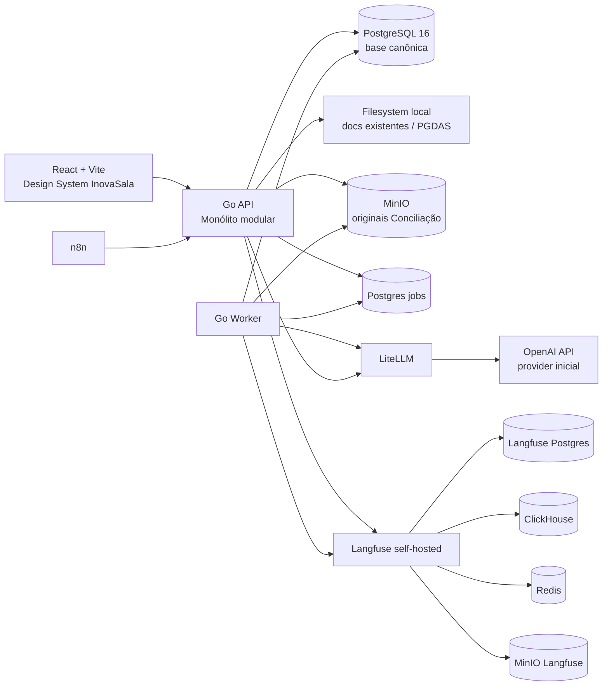

# 04 — System Design

## 1. Objetivo técnico

Consolidar os três produtos numa única aplicação web baseada no monólito modular Go + React do `controle-tarefas`, preservando serviços auxiliares e contratos comportamentais dos módulos especializados.

## 2. Estado atual

### Controle de Tarefas
- Backend Go 1.26+, `chi`, `pgx`, `sqlc`, `goose`.
- Frontend React/TypeScript/Vite.
- PostgreSQL 16.
- OpenAPI 3.1 como contrato.
- Storage local em `FILE_STORAGE_DIR` para capacidades existentes.
- Testes Go/Testcontainers, Vitest, Playwright.

### Fator R
- Next.js + FastAPI/Python + PostgreSQL.
- Langfuse self-hosted para observabilidade.
- Upload local/volume para PGDAS-D.
- Agentes e motor tributário separados; cálculo determinístico.

### Conciliador
- FastAPI/Jinja/HTMX/Python + PostgreSQL.
- MinIO versionado para originais.
- LiteLLM.
- n8n.
- Worker e fila em PostgreSQL.
- Regras determinísticas para validação, matching e classificação.

## 3. Arquitetura proposta



## 4. Decisões arquiteturais

### DEC-001 — Monólito modular Go/React como aplicação canônica

**Status:** Accepted.  
**Decisão:** novos domínios de Fator R e Conciliação são portados para módulos Go e features React no repositório-base.  
**Não significa:** remover serviços auxiliares, reescrever regras de negócio ou alterar resultado funcional.

### DEC-002 — Empresa única

Extensões dos módulos referenciam `companies.id`. Não existe cadastro paralelo de cliente/escritório.

### DEC-003 — Serviços auxiliares preservados

Manter MinIO, LiteLLM, n8n e Langfuse porque fazem parte dos comportamentos e operações dos projetos existentes. O objetivo não é reduzir containers, e sim consolidar produto.

### DEC-004 — Storage por responsabilidade

Não migrar todos os arquivos para um backend único apenas para padronizar:
- Controle: filesystem local atual.
- Fator R: retenção local dedicada conforme semântica atual.
- Conciliação: MinIO versionado.
- Langfuse: stack/storage próprios.

### DEC-005 — OpenAI via LiteLLM e aliases

Todos os agentes novos/portados resolvem modelo por alias via LiteLLM. Provider inicial OpenAI. Modelo concreto é configuração, não regra de domínio.

### DEC-006 — Observabilidade dupla

O banco da aplicação guarda a auditoria necessária para reconstruir o fato de domínio. Langfuse é a camada de observabilidade/eval. Se Langfuse falhar, o domínio continua e marca sincronização pendente.

### DEC-007 — Fechamento Contábil único

`company_module_periods` do módulo Contábil é a única autoridade de fechamento. A Conciliação consulta esse estado e não cria autoridade concorrente.

### DEC-008 — Upload manual como jornada da demo; n8n preservado

A demo e critérios obrigatórios usam upload manual. n8n continua na stack e pode chamar endpoints de ingestão, mas não é dependência para provar o fluxo principal.

## 5. Módulos Go propostos

Preservar os módulos atuais e adicionar, preferencialmente:

```text
backend/internal/
  factor_r/
    domain/
    service/
    repository/
    parser/
    agents/
    http/
  reconciliation/
    domain/
    service/
    repository/
    agents/
    matching/
    extraction/
    http/
  ai/
    config/
    litellm/
    tracing/
    prompts/
  jobs/
  documents/
```

A estrutura exata deve se alinhar ao padrão atual do repositório após exploração. Não criar camadas artificiais só para imitar esta árvore.

## 6. Frontend

```text
frontend/src/features/
  factor-r/
  reconciliation/
  documents/
  ai-settings/
```

Reutilizar:
- React Router.
- TanStack Query.
- TanStack Table/Virtual.
- React Hook Form + Zod.
- componentes existentes, adaptados ao Design System InovaSala quando o arquivo estiver disponível.

## 7. Fila e workers

### Requisitos

- Fila em PostgreSQL, preservando `SELECT ... FOR UPDATE SKIP LOCKED` do Conciliador.
- Retry limitado e dead-letter/estado terminal.
- Job armazena tipo, payload referencial (IDs, não blobs), tentativas, erro sanitizado e timestamps.
- Worker Go separado do processo HTTP ou modo de execução separado do mesmo binário, para preservar isolamento operacional.
- Cada execução resolve/snapshot o alias/modelo no início.

### Tipos de job iniciais

- `pgdas_parse`
- `statement_triage`
- `statement_extract`
- `receipt_extract`
- `reconciliation_run`
- `agent_resolver`
- `langfuse_sync_retry`

> **Desde a TASK-019 (D-030):** `agent_resolver` pede ao resolvedor a hipótese de uma linha do extrato: a pedido do contador ou, com `RESOLVEDOR_AUTOMATICO`, pela rodada do matching. Grava só a proposta.

## 8. LiteLLM

Manter aliases e expandir para todos os agentes:

- `triador`
- `extrator`
- `extrator_forte`
- `resolvedor`
- `consultor`
- `priorizador`
- `classificador` (se o fluxo original exigir sugestão agentic separada)

O `parser_pgdas` não tem alias de modelo: o parser do PGDAS-D é determinístico (ADR-006).

Configuração efetiva deve poder ser derivada de defaults `.env` e overrides persistidos pela UI. Secrets permanecem no processo LiteLLM/provedor.

## 9. Langfuse

Manter stack self-hosted do Fator R, incluindo web/worker/Postgres/ClickHouse/Redis/MinIO. Ajustar nome de organização/projeto apenas se necessário para refletir o produto unificado, sem destruir dados/compatibilidade por padrão.

Cada trace deve usar `trace_id` correlacionável com o registro local.

## 10. Contratos congelados durante o porte

### Fator R
- fórmula e janela;
- limiar legal 28%;
- meta operacional 30%;
- regras de PGDAS-D;
- simulador/vereditos;
- agente não calcula domínio;
- evals/tracing.

### Conciliação
- schema lógico do extrator de extrato;
- tolerância R$ 0,00;
- chave de dedupe;
- 3 tentativas do extrator;
- playbook;
- passes 1–4;
- resolvedor só propõe;
- classificação regra → histórico → agente;
- original imutável;
- razão derivado.

Mudança exige ADR + aprovação humana.

> **Na TASK-018:** os passes 1–4 ganharam, com aprovação do usuário, a ambiguidade dos dois lados, os casos de borda fora do automático e os parciais só depois da revisão (ADR-008). Os critérios de cada passe são os da origem.
>
> **Na TASK-019 (D-030):** o resolvedor só propõe. Só duas consultas criam conciliação, a da rodada determinística e a do aceite humano, e um teste prova no código que o agente não chama nenhuma delas.

## 11. Performance

- Preservar baseline do Controle: ~300 empresas.
- Fator R: carteira do volume de demonstração deve permanecer em uma única experiência de tela sem latência perceptível anormal.
- Conciliação: parsing/LLM é assíncrono; requests síncronos não esperam modelo.
- Evitar N+1 em dashboard/ficha; usar queries agregadas.
- Paginar documentos/traces quando crescerem.

## 12. Segurança

- Aplicação principal sem login por decisão de produto local-only.
- Langfuse mantém autenticação administrativa própria.
- MinIO/LiteLLM usam credenciais por `.env`.
- API keys nunca passam ao frontend.
- Upload valida tipo/tamanho e não serve arquivos diretamente de diretório público.
- Logs sanitizam CNPJ/PII conforme contratos existentes dos módulos quando enviados ao Langfuse.

## 13. Rollback arquitetural

O porte deve ser feito por vertical slices sem apagar/reduzir funcionalidades do projeto-base. Como os dois módulos de origem estão em repositórios separados e não há migração de dados reais, rollback de cada slice consiste em reverter migrations aditivas/código no repositório-base antes de merge, preservando os repositórios fonte intactos.

[SECURITY][BLOCKER] Migration destrutiva ou exclusão de dado/arquivo exige aprovação humana explícita.
