# 07 — Fluxos do Sistema Integrado

## F-001 — Navegação e empresa canônica

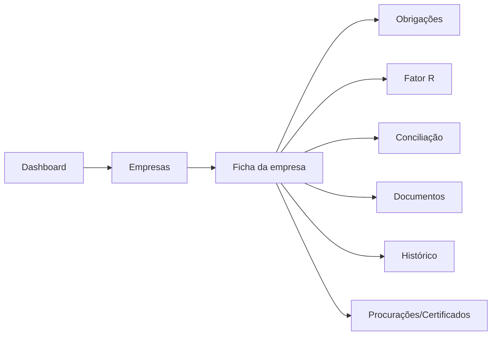

Regra: todas as áreas usam o mesmo `company_id`.

## F-002 — Upload e processamento PGDAS-D

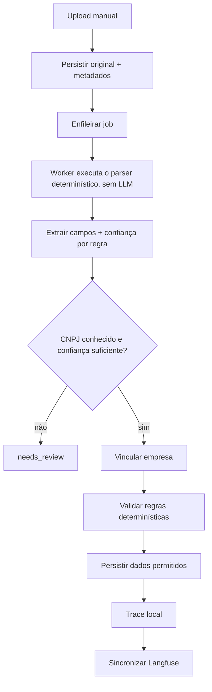

Exceções:
- CNPJ desconhecido: revisão; cadastro assistido somente por confirmação humana.
- Série já preenchida: não sobrescrever.
- Langfuse fora: domínio conclui; `langfuse_sync=failed` e retry.

## F-003 — Cálculo Fator R

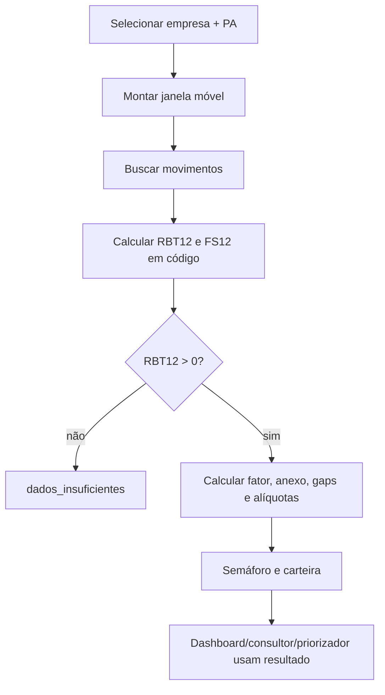

LLM não participa de B–H.

## F-004 — Upload e extração de extrato bancário

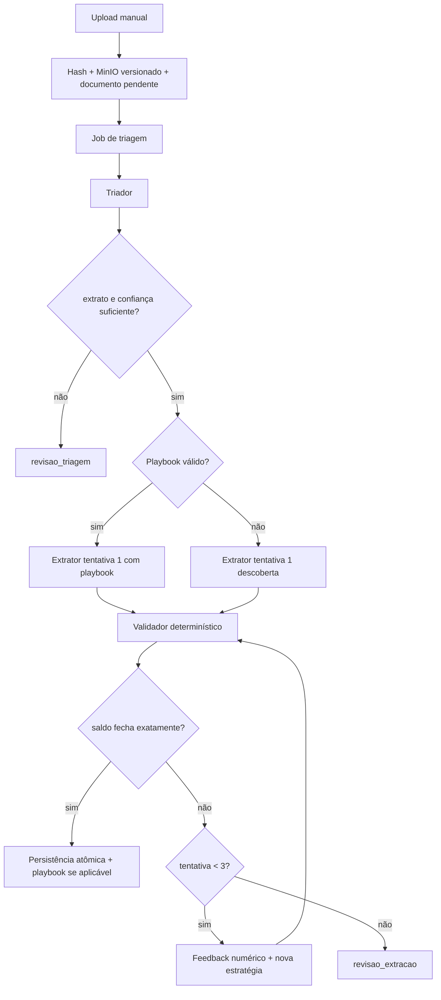

Regra crítica: não existe caminho de persistência de `extrato_transacao` com portão reprovado.

> **Como foi implementado (TASK-016; D-027).**
> - Antes do triador roda o leitor determinístico do PDF (o `processar_local` da origem), agora no job. Com o saldo fechando, importa sem LLM (tentativas = 0); senão, o documento segue para o triador.
> - O CSV do banco triado como extrato é lido pelo leitor determinístico, sem o extrator.
> - A persistência atômica resolve a empresa (pela conta cadastrada ou pelo envio) e respeita o fechamento do Contábil: fechado, o documento fica `pendencia_periodo_fechado`.

## F-005 — Comprovante

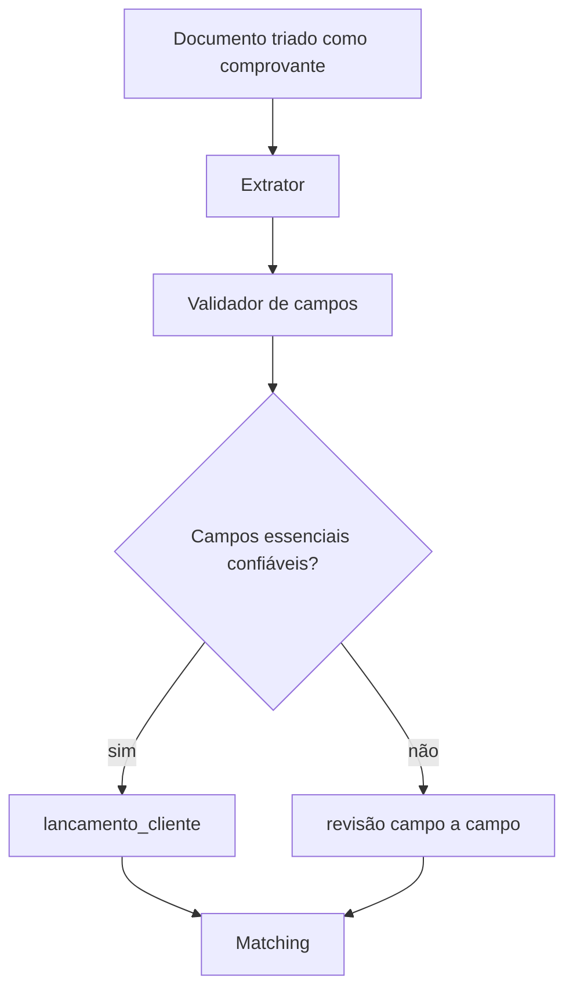

Campo de baixa confiança não é inventado.

> **Como foi implementado (TASK-017; D-028).**
> - No job de triagem roda antes o leitor determinístico do comprovante (o `processar_local` da origem). Vale a leitura com a empresa do documento achada no comprovante e os campos essenciais válidos; senão, o documento segue para o triador e o extrator.
> - O extrator lê primeiro o texto; com saída inválida ou campo essencial fraco, lê de novo com as páginas renderizadas (até 2 chamadas). Sem texto, vai a imagem.
> - O validador de campos (M3.4) deixa o lançamento `parcial` com campo nulo, inválido ou abaixo de `LIMIAR_CAMPO`; a duplicata de leiaute diferente é sinalizada; o Contábil fechado na competência deixa o documento em `pendencia_periodo_fechado`.

## F-006 — Matching e resolvedor

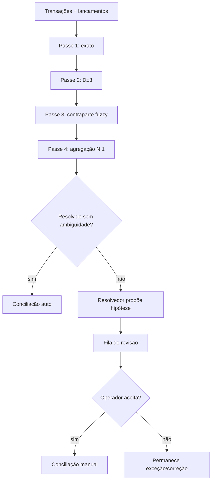

> **Como foi implementado (TASK-018; D-029, ADR-008).**
> - Antes do passe 1, o pré-filtro da origem e os casos de borda tiram linhas do automático, com o motivo marcado para a fila.
> - Cada passe só concilia o que não é ambíguo dos dois lados: o comprovante disputado vira divergência e ainda pode ser resolvido pelo passe seguinte.
> - Só entram os lançamentos extraídos e manuais; o parcial espera a revisão. O resolvedor (TASK-019) fica para os remanescentes.
>
> **Desde a TASK-019 (D-030):** o resolvedor roda no worker, a pedido do contador ou, com `RESOLVEDOR_AUTOMATICO`, depois da rodada. Grava a proposta; o aceite cria a conciliação manual e a rejeição a encerra ("permanece exceção"). Nada é conciliado sem o aceite.

## F-007 — Classificação e razão

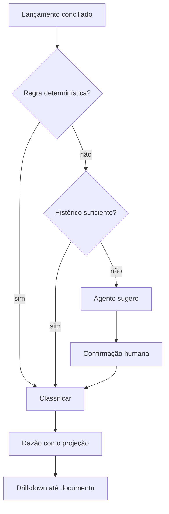

> **Como foi implementado (TASK-020; D-031).**
> - A regra e o histórico (as classificações confirmadas dos meses anteriores, a mais recente vale) rodam ao conciliar: na rodada do matching e no aceite do resolvedor.
> - Sem os dois, a linha fica à espera; o agente sugere a pedido do contador (ou com `CLASSIFICADOR_AUTOMATICO`), e a sugestão só vale aceita.
> - A correção do contador propõe a regra derivada, que só vale confirmada. O razão é consulta sobre as conciliações ativas, com drill-down até os originais.

## F-008 — Integração Conciliação → Obrigação Contábil

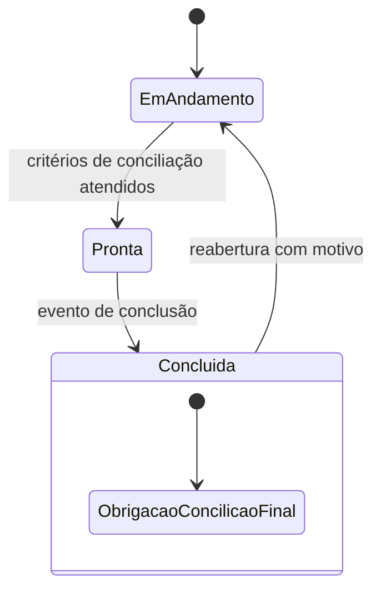

Ao entrar em `Concluida`:
- localizar instância canônica da obrigação `Conciliação` da empresa/competência;
- aplicar status final apropriado pelo serviço de obrigações;
- usar `change_source=SYSTEM_INTEGRATION`;
- ser idempotente.

Ao reabrir:
- reverter para status operacional não final definido pelo catálogo;
- registrar motivo e evento.

> **Como foi implementado (TASK-022; D-036).**
> - **Pronta:** ao menos um extrato importado cobre a competência, toda linha conciliada (ou sem comprovante) e classificada, nada em revisão; comprovante sem extrato só avisa.
> - **Conclusão:** o contador confirma; a obrigação Conciliação vai para OK pelo serviço de obrigações (`SYSTEM_INTEGRATION`, dependências HARD valendo), na mesma transação; idempotente.
> - **Concluída:** a competência trava para a Conciliação (423 `RECONCILIATION_COMPLETED`), e documento novo vira pendência.
> - **Reabertura:** com motivo; a obrigação volta para Pendente, se ainda estiver no OK da conclusão (mudança humana no Controle prevalece). Com o Contábil fechado, nem conclui nem reabre.

## F-009 — Fechamento Contábil canônico

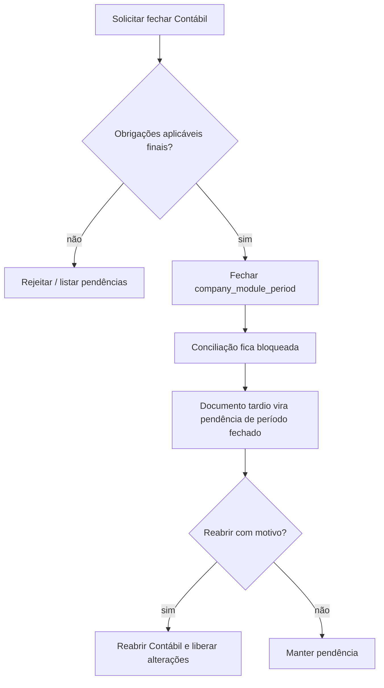

Não criar uma segunda tabela de fechamento com autoridade concorrente.

> **Como foi implementado (TASK-023; D-037).** Por decisão do usuário, o passo "obrigações aplicáveis finais?" confere só a obrigação Conciliação, e só quando a empresa usa a Conciliação na competência (extrato que a cobre ou documento dela): fora disso, o Contábil fecha como sempre. A recusa é 422 `RECONCILIATION_NOT_FINAL`. Fechado, a Conciliação trava (423 `PERIOD_CLOSED`) e o documento tardio vira pendência; reaberto com motivo, as alterações voltam, e o documento tardio segue pendente até alguém reprocessar (decisão do usuário).

## F-010 — Troca de modelo de IA

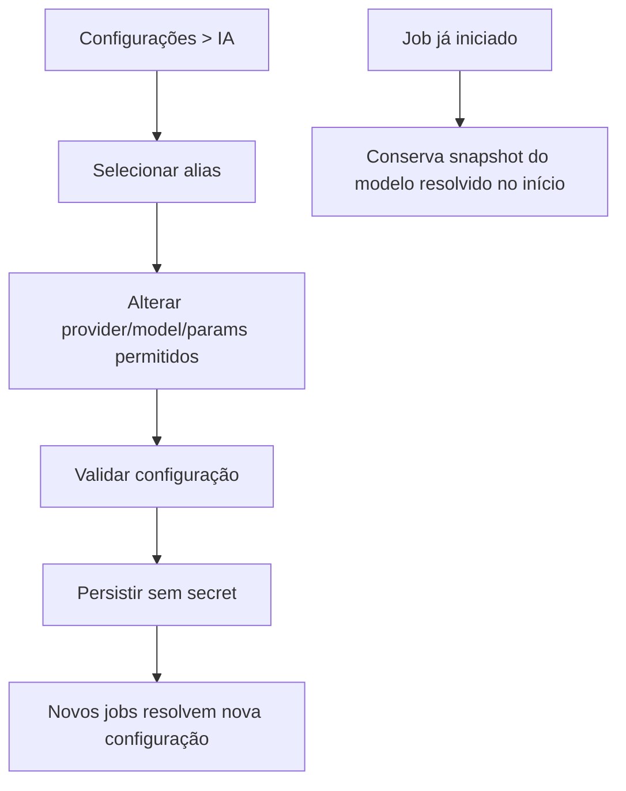

API keys continuam apenas no ambiente do LiteLLM/provedor.

## F-011 — Falha de Langfuse

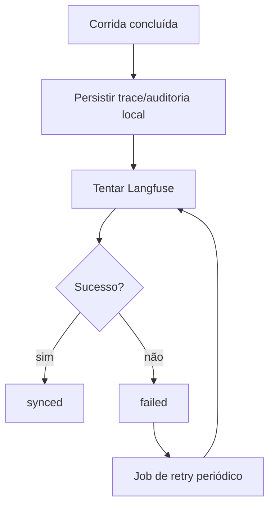

## F-012 — Demonstração

1. `make dev` sobe aplicação e serviços necessários.
2. `make migrate` aplica schema consolidado.
3. `make seed-demo` cria dados de referência e empresas fictícias.
4. Fixtures associam ao menos:
   - duas empresas com série Fator R;
   - uma empresa com PGDAS-D fictício;
   - uma empresa com cenário de conciliação completo;
   - obrigações mensais e backlog do Controle.
5. Operador percorre Dashboard → Empresa → Fator R → Conciliação → fechamento Contábil → histórico.

> **Como foi implementado (TASK-027; D-041).** O `make seed-demo` carrega as 21 empresas fictícias (as 20 do Controle e a 111 Construtora Horizonte), com as obrigações, o histórico, o backlog e a série do Fator R. Com o `make dev` no ar, o `make demo-fixtures` carrega na 111 o cenário completo da Conciliação de 08/2026 e grava em `demo/pgdas` os extratos do PGDAS-D para o inbox. A jornada passa pelo Dashboard, pela ficha da 111, pelo Fator R (carteira e inbox), pela fila da Conciliação de 08/2026 e pelo fechamento do Contábil, recusado até a conciliação concluída, e termina no histórico.
